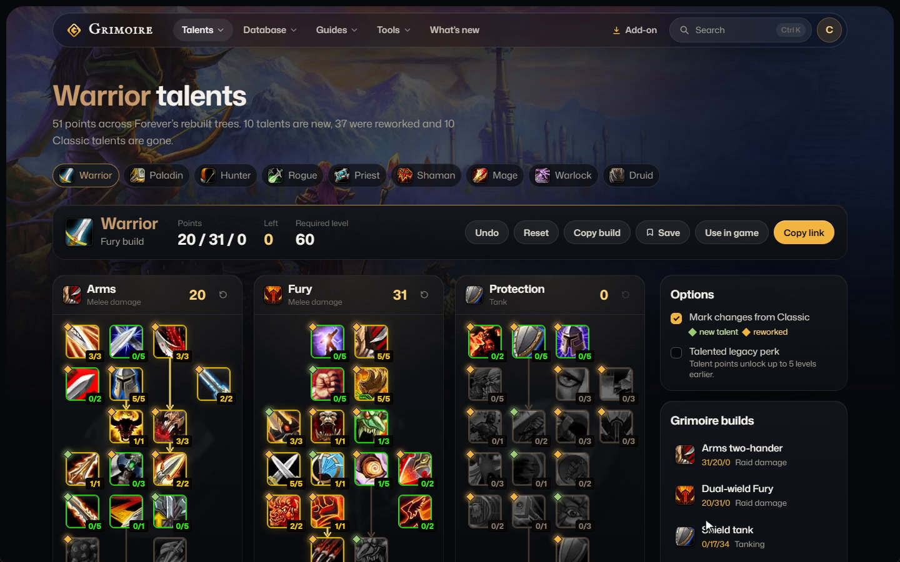
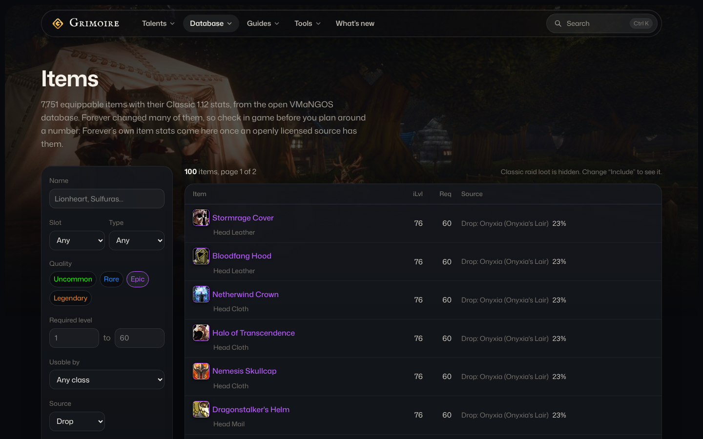
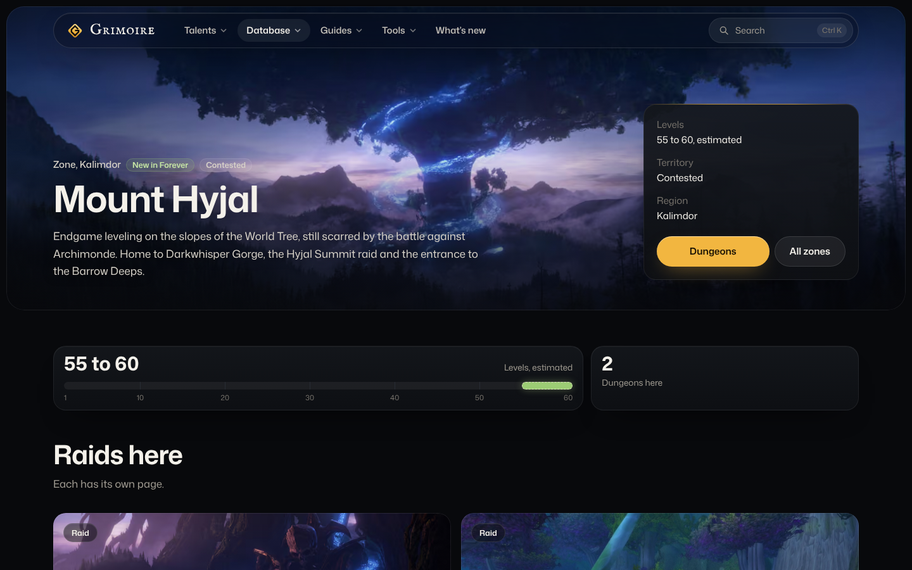

<div align="center">

# Grimoire

Talent calculator, builds, leveling routes, database, guides and in-game add-on for World of Warcraft: Forever.

**[wowgrimoire.app](https://wowgrimoire.app)** · [Add-on](https://www.curseforge.com/wow/addons/grimoire-field-guide) · [Case study](https://gimzdev.com/work/grimoire?utm_source=github)

<sub>Next.js · TypeScript · PostgreSQL · Lua</sub>


<table>
<tr>
<td align="center" width="50%"><br><sub>Home</sub></td>
<td align="center" width="50%"><br><sub>Talent calculator</sub></td>
</tr>
<tr>
<td align="center" width="50%"><br><sub>Item database</sub></td>
<td align="center" width="50%"><br><sub>Mount Hyjal</sub></td>
</tr>
</table>

<hr>

</div>

Grimoire is a field guide for World of Warcraft: Forever. Plan a talent build, look up where a quest or drop comes
from, and follow a leveling route, on the site or in game with its add-on. Its game data comes from openly licensed
projects, and the scripts that rebuild it are in the repo.

## What it does

- **Talent calculator and builds.** The nine rebuilt classes, with what changed from Classic, and 84 builds: leveling, PvE and PvP for every spec, each checked against the live trees. The leveling, raid, tank and healing builds are also compared with the Icy Veins, Wowhead and Mobalytics guides. Copy a build or its link, or use it in game.
- **Leveling routes.** 56 routes from level 1 to 60, one for each race and class, with Forever's own quests.
- **Database.** Items, quests, NPCs, zones and 37 dungeons and raids, with loot tables and drop chances.
- **Guides.** 24 guides: getting started, leveling 1 to 60, every class, professions and more.
- **Planners.** Raid composer, gear planner, Legacy challenges and perk planner.
- **In-game add-on.** The leveling route with an arrow, talent builds point by point, dungeon maps with their loot and gear upgrades, in game (`addon/`, on [CurseForge](https://www.curseforge.com/wow/addons/grimoire-field-guide)).
- **Accounts.** Optional: keep your talent builds, Legacy builds, raid comps and Legacy progress on your profile.
- **Search.** Ctrl K on any page finds items, quests and talents.

## How it is built

Next.js (App Router), React, TypeScript and Tailwind CSS. PostgreSQL and Better Auth for the optional accounts. The
add-on is Lua.

- **Openly licensed data.** `scripts/data/build.mjs` rebuilds every file in `data/` from four openly licensed projects and Grimoire's own hand-written facts. Nothing is read from World of Warcraft database sites.
- **Routes are worked out, not copied.** Each route comes from simulating a character of that race and class who walks, flies and sails from quest to quest, earns the experience, picks up flight paths and trains on the way. A check script holds every route to the same bar.
- **Dungeon maps without game art.** Every creature, patrol point and object the world database places in an instance marks floor that people walk on. Marching squares turns those points into a floor plan, floor by floor, with each boss where it spawns.
- **One data set, two products.** `npm run addon` builds the add-on's Lua tables and its zip from the same `data/` the site reads, and the add-on's code is tested in a Lua VM against a fake game client.

## Run it

```bash
git clone https://github.com/gimzdev/grimoire.git
cd grimoire
npm ci
npm run dev        # http://localhost:3000
npm run addon      # the add-on: addon/dist/GrimoireForever-<version>.zip
```

Node.js 20.9 or newer. The game data is in `data/`, so the site runs without keys, and accounts stay off without a
database. [scripts/data/README.md](scripts/data/README.md) says how to rebuild the data from its sources.

I keep the whole app in one bash script: it writes these files, installs the app and deploys it to Vercel. This
repository is what it writes, pushed after each deploy.

## Licence and credits

Code under the [GPL-3.0-or-later](LICENSE). Data from [talentsforever.com](https://talentsforever.com) (CC BY 4.0),
[LibQuestDB](https://www.curseforge.com/wow/addons/questdb) (MIT), [QuestieDB](https://github.com/Questie/QuestieDB)
(GPLv3) and [VMaNGOS](https://github.com/vmangos/core) (GPL-2.0-or-later). Each data file stays under the terms of
its source: full credits, licence texts and what Grimoire changed are in [NOTICE.md](NOTICE.md).

<sub>Fan-made, not affiliated with or endorsed by Blizzard Entertainment. World of Warcraft and Warcraft are trademarks or registered trademarks of Blizzard Entertainment, Inc. Game names, text, icons and art © Blizzard Entertainment, Inc.</sub>

<div align="center">

<hr>

<sub>Made by <a href="https://gimzdev.com/?utm_source=github">Gimz</a> in Montréal · <a href="https://discord.gg/gY5PsymH">Discord</a> · <a href="https://www.patreon.com/gimzdev">Support on Patreon</a></sub>

<sub><a href="https://github.com/gimzdev">More by Gimz</a>: <a href="https://github.com/gimzdev/metaforge">MetaForge</a> · <a href="https://github.com/gimzdev/patchlab">Patchlab</a> · <a href="https://github.com/gimzdev/mosaik">Mosaïk</a> · <a href="https://github.com/gimzdev/dropdate">Dropdate</a></sub>

</div>
