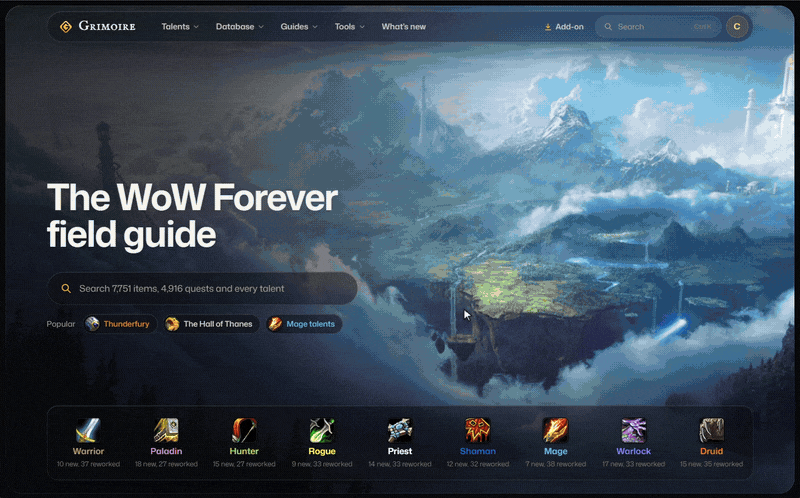
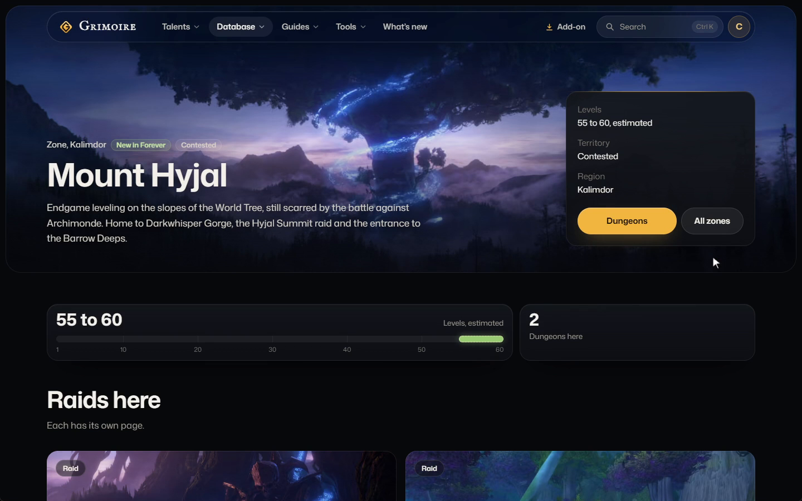

# Grimoire

Talent calculator, database, guides and in-game add-on for World of Warcraft: Forever.

[wowgrimoire.app](https://wowgrimoire.app) · [Add-on](https://www.curseforge.com/wow/addons/grimoire-field-guide) · Next.js · TypeScript · PostgreSQL · Lua

<table>
<tr>
<td align="center" width="50%"> Home</td>
<td align="center" width="50%"> Talent calculator</td>
</tr>
<tr>
<td align="center" width="50%"> Item database</td>
<td align="center" width="50%"> Mount Hyjal</td>
</tr>
</table>

Grimoire is a field guide for World of Warcraft: Forever. Plan a talent build, look up where a quest or drop
comes from, and follow a leveling route, on the site or in game with its add-on. Its game data comes from
openly licensed projects, and the scripts that rebuild it are in the repo.

| | |
|:---|:---|
| **Talent calculator** | The nine rebuilt classes, with what changed from Classic; copy a build or its link |
| **Database** | Items, quests, NPCs, zones, dungeons and raids, with loot tables and drop chances |
| **Guides** | Getting started, leveling 1 to 60, every class |
| **Planners** | Leveling route, raid composer, Legacy challenges and perk planner with Grimoire's builds |
| **In-game add-on** | The leveling route with an arrow, gear upgrades, dungeons and talents in game (`addon/`) |
| **Accounts** | Optional: keep your talent builds, Legacy builds, raid comps and Legacy progress on your profile |

Press Ctrl K on any page to search items, quests and talents.

Code under the [GPL-3.0-or-later](LICENSE). Data from [talentsforever.com](https://talentsforever.com) (CC BY 4.0), [LibQuestDB](https://www.curseforge.com/wow/addons/questdb) (MIT) and [VMaNGOS](https://github.com/vmangos/core) (GPL-2.0-or-later): full credits in [NOTICE.md](NOTICE.md).

Fan-made, not affiliated with or endorsed by Blizzard Entertainment. World of Warcraft and Warcraft are trademarks or registered trademarks of Blizzard Entertainment, Inc. Game names, text, icons and art © Blizzard Entertainment, Inc.

