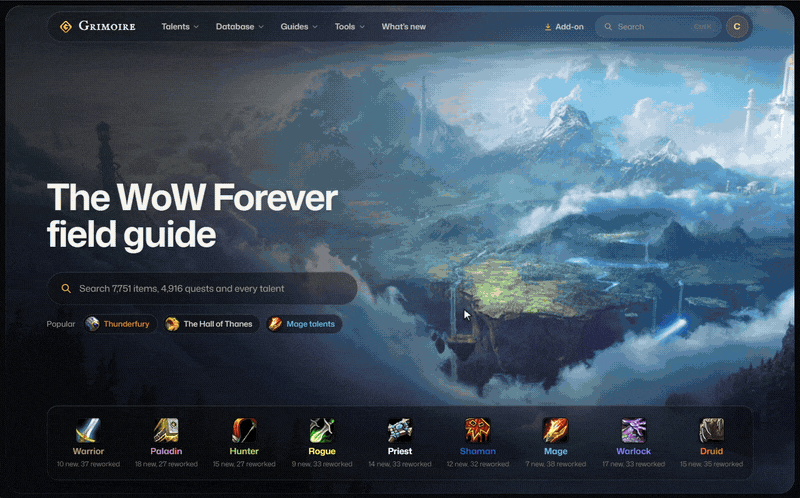
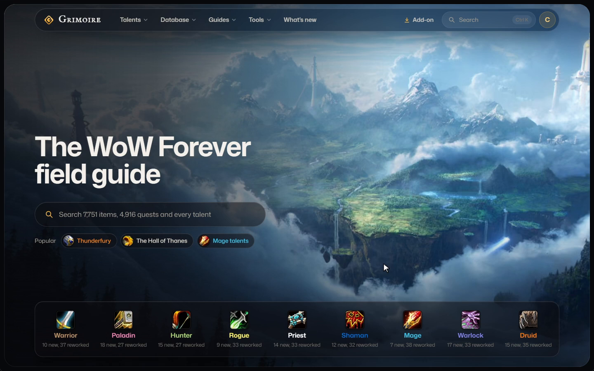

<h1 align="center">Grimoire</h1>

<p align="center">WoW Forever field guide</p>

<p align="center"><b><a href="https://wowgrimoire.app">wowgrimoire.app</a></b> · <a href="https://www.curseforge.com/wow/addons/grimoire-field-guide">Add-on</a> · <a href="https://www.gimzdev.com/work/grimoire?utm_source=github">Case study</a></p>

<p align="center"></p>

Grimoire is a field guide for World of Warcraft: Forever. Plan a talent build, look up where a quest or drop comes
from, and follow a leveling route, on the site or in game with its add-on. Its game data comes from openly licensed
projects, and the scripts that rebuild it are in the repo.

## Features

- **Talent calculator.** The nine rebuilt classes, with what changed from Classic. Copy a build or its link, or use it in game.
- **Builds.** 84 builds: leveling, PvE and PvP for every spec.
- **Leveling routes.** 56 routes from level 1 to 60, one for each race and class, with Forever's own quests.
- **Database.** Items, quests, NPCs, zones and 37 dungeons and raids, with loot tables and drop chances.
- **Guides.** 24 guides: getting started, leveling 1 to 60, every class, professions and more.
- **Planners.** Raid composer, gear planner, Legacy challenges and perk planner.
- **In-game add-on.** The leveling route with an arrow, talent builds point by point, dungeon maps with their loot and gear upgrades (`addon/`, on [CurseForge](https://www.curseforge.com/wow/addons/grimoire-field-guide)).
- **Accounts.** Optional: keep your talent builds, Legacy builds, raid comps and Legacy progress on your profile.
- **Search.** Ctrl K on any page finds items, quests and talents.

<p align="center">   </p>

## Built with

Next.js (App Router), React, TypeScript and Tailwind CSS. PostgreSQL and Better Auth for the optional accounts. The
add-on is Lua.

<details>
<summary>Implementation notes</summary>

- **Data.** `scripts/data/build.mjs` rebuilds every file in `data/` from four openly licensed projects and Grimoire's own hand-written facts. Nothing is read from World of Warcraft database sites.
- **Routes.** Each route comes from simulating a character of that race and class who walks, flies and sails from quest to quest, earns the experience, picks up flight paths and trains on the way. A check script runs on every route.
- **Dungeon maps.** Every creature, patrol point and object the world database places in an instance marks floor that people walk on. Marching squares turns those points into a floor plan, floor by floor, with each boss where it spawns.
- **Add-on.** `npm run addon` builds the add-on's Lua tables and its zip from the same `data/` the site reads, and the add-on's code is tested in a Lua VM against a fake game client.

</details>

## Run it

```bash
git clone https://github.com/gimzdev/grimoire.git
cd grimoire
npm ci
npm run dev        # http://localhost:3000
npm run addon      # the add-on: addon/dist/GrimoireForever-<version>.zip
```

Node.js 20.9 or newer. The game data is in `data/`, so the site runs without keys, and accounts stay off without a
database. [scripts/data/README.md](scripts/data/README.md) says how to rebuild the data from its sources.

This repository is written by one script, which also installs and deploys the app, and is pushed after each deploy.

## Licence and credits

Code under the [GPL-3.0-or-later](LICENSE). Data from [talentsforever.com](https://talentsforever.com) (CC BY 4.0),
[LibQuestDB](https://www.curseforge.com/wow/addons/questdb) (MIT), [QuestieDB](https://github.com/Questie/QuestieDB)
(GPLv3) and [VMaNGOS](https://github.com/vmangos/core) (GPL-2.0-or-later). Each data file stays under the terms of
its source: full credits, licence texts and what Grimoire changed are in [NOTICE.md](NOTICE.md).

<sub>Fan-made, not affiliated with or endorsed by Blizzard Entertainment. World of Warcraft and Warcraft are trademarks or registered trademarks of Blizzard Entertainment, Inc. Game names, text, icons and art © Blizzard Entertainment, Inc.</sub>

<p align="center"><sub><a href="https://www.gimzdev.com/?utm_source=github">Gimz</a> · <a href="https://github.com/gimzdev/metaforge">MetaForge</a> · <a href="https://github.com/gimzdev/patchlab">Patchlab</a> · <a href="https://github.com/gimzdev/mosaik">Mosaïk</a> · <a href="https://github.com/gimzdev/dropdate">Dropdate</a></sub></p>
