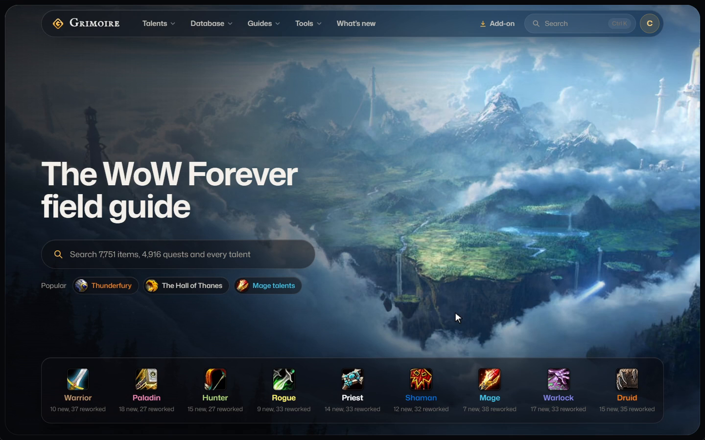
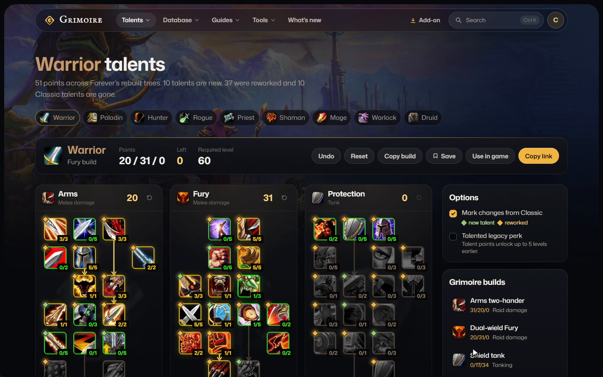
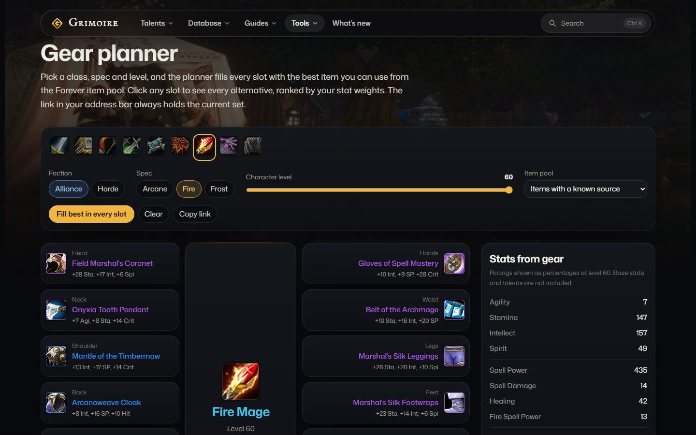
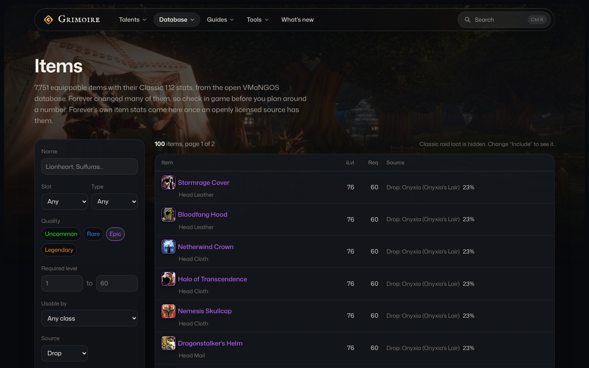

<div align="center">

# Grimoire

Talent calculator, gear planner and database for World of Warcraft: Forever.

[wowgrimoire.app](https://wowgrimoire.app) · Next.js · React

</div>

<table>
<tr>
<td align="center" width="50%"><br><sub>Home</sub></td>
<td align="center" width="50%"><br><sub>Talent calculator</sub></td>
</tr>
<tr>
<td align="center" width="50%"><br><sub>Gear planner</sub></td>
<td align="center" width="50%"><br><sub>Item database</sub></td>
</tr>
</table>

## What's in it

- **Talent calculator** for the nine rebuilt classes, with what changed from Classic; copy a build or its link
- **Gear planner**: the best item for every slot at your level, and the alternatives
- **Database**: items, quests, NPCs, zones, dungeons and raids, with loot tables and drop chances
- **Guides**: getting started, leveling 1 to 60, every class; plus a leveling route, a raid composer and a Legacy planner

Search finds items, quests and talents from any page with Ctrl K.

## Run it

```bash
npm install
npm run dev
```

No accounts, keys or databases: the game data ships with the site.

<sub>Grimoire is a fan-made site, not affiliated with or endorsed by Blizzard Entertainment. World of Warcraft and related names are trademarks of Blizzard Entertainment, Inc. Icons from Wowhead; Classic quest and loot data from VMaNGOS.</sub>
